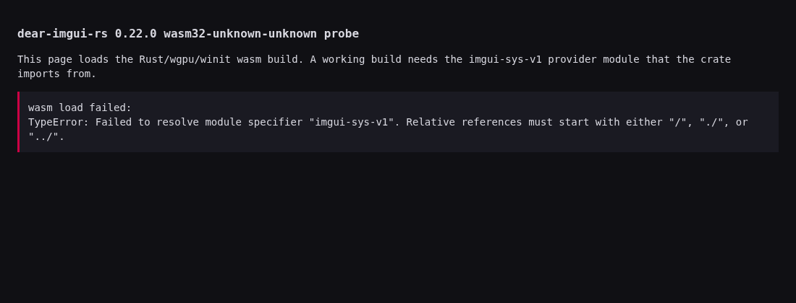

# dear-imgui-rs 0.22 minimal demo

One Dear ImGui window, two targets:

1. Native `winit` + `wgpu` window.
2. `wasm32-unknown-unknown` build running in a browser on WebGL2.

Both are verified on NixOS 26.11 / niri (Wayland):

| Native | Browser |
|---|---|
|  |  |

## Dependencies and the one build-time exception

The application's Cargo graph is crates.io-only: `Cargo.lock` contains only registry packages and
no git sources.

The browser target additionally needs the `imgui-sys-v1` WebAssembly provider. `dear-imgui-rs
0.22` deliberately ships only import bindings on wasm; the provider is built by the upstream
repository's `xtask` with Emscripten and is not published on crates.io. The provider is
generated once from the pinned 0.22.0 release commit (`7424350...`) and copied into
`web/provider/` as three static files (gitignored). No repository code is vendored into the
crate or linked into the application.

| Component | Version |
|---|---|
| `dear-imgui-rs` | 0.22.0 |
| `dear-imgui-winit` | 0.22.0 |
| `dear-imgui-wgpu` | 0.22.0 (wgpu 30) |
| `winit` | 0.30.13 |
| Rust | 1.99.1 (`rust-version = 1.95` required by the crates) |
| wasm-bindgen | 0.2.130 |
| Dear ImGui | 1.93.1 WIP docking |

## Native (winit)

```sh
nix develop -c cargo run
```

`WinitPlatform::prepare_frame`, `Context::frame`, `Context::render` and `WgpuRenderer::render`
run every frame; the renderer is shut down explicitly before the context is dropped.

## wasm32 (browser)

Prerequisites: `nix` (for the pinned Emscripten toolchain), network access for the first
provider build, and a browser with WebGL2.

```sh
nix develop -c make provider   # build imgui-sys-v1 from the pinned upstream checkout
nix develop -c make web        # build the app, run wasm-bindgen, patch shared memory
nix develop -c make serve      # http://127.0.0.1:8088/
```

`make provider` clones `Latias94/dear-imgui-rs` into `.provider-src/` at commit
`7424350518efb54693b8acd4a417b69d9d0f015b`, builds the app demo and the provider with
Emscripten, and copies `imgui-sys-v1.{js,wasm}` plus `imgui-sys-v1-wrapper.js` to
`web/provider/`. The app's wasm is built by `make web` without any upstream source.

Runtime wiring:

1. `web/index.html` creates `globalThis.__imgui_shared_memory` (2048 pages, maximum 4096) before
   any module script runs, and installs an import map for the bare specifier `imgui-sys-v1`.
2. The provider wrapper is an ES module with top-level `await`; it instantiates the Emscripten
   module with that memory. The provider places its static data at 64 MiB
   (`GLOBAL_BASE=67108864`), leaving the low region to the Rust module.
3. `scripts/patch_web_glue.py` converts the wasm-bindgen module's own memory into an import of
   `env.memory` (WAT round trip through `wasm-tools`) and injects the shared memory into the
   generated init code, so both modules address one linear memory.
4. On wasm the app requests `wgpu::Backends::GL`. WebGL2 limits are taken from the adapter via
   `Limits::downlevel_webgl2_defaults().using_resolution(...)`, which the browser requires
   (the default limits request `max_compute_workgroups_per_dimension = 65535`).

Verified in Chromium: continuous rendering, frame counter increasing (572 -> 840 between two
screenshots). Headless verification needs SwiftShader:

```sh
nix run nixpkgs#chromium -- --headless=new --no-sandbox \
  --use-gl=angle --use-angle=swiftshader --enable-unsafe-swiftshader \
  --window-size=900,600 --virtual-time-budget=8000 \
  --screenshot=/tmp/wasm.png http://127.0.0.1:8088/
```

## Upstream toolchain notes

- Emscripten 6 removed the `allocate` runtime helper that the 0.22.0 `xtask` still lists in
  `EXPORTED_RUNTIME_METHODS`; the provider build aborts during JS finalization. The build script
  strips that single entry from the local checkout: `scripts/patch_xtask_emscripten.py`.
- The 0.22.0 `xtask` also patches the generated wasm-bindgen glue by searching for
  `const imports = {};`, which wasm-bindgen 0.2.130 no longer emits. Its injection lands in the
  wrong scope and throws `ReferenceError: imports is not defined`. This project does not use that
  injection; `scripts/patch_web_glue.py` patches the current glue at
  `const imports = __wbg_get_imports();` and inserts the environment memory there.

## crates.io-only variant

`web/probe.html` loads the same application without the provider and without the import map. It
demonstrates the constraint discussed above: the module imports the bare specifier
`imgui-sys-v1`, so the browser raises

```
TypeError: Failed to resolve module specifier "imgui-sys-v1".
```



The application wasm itself already imports 86 `imgui-sys-v1` functions after dead-code
elimination; see `wasm-objdump -x target/wasm32-unknown-unknown/release/dear_imgui_demo.wasm`.

## Layout

| Path | Purpose |
|---|---|
| `src/lib.rs` | Shared application, native entry, wasm entry |
| `src/main.rs` | Native binary |
| `web/index.html` | Working page: shared memory, import map, error overlay |
| `web/probe.html` | crates.io-only failure page |
| `scripts/build-provider.sh` | Builds the pinned provider into `web/provider/` |
| `scripts/patch_web_glue.py` | Shared-memory patch for the app wasm and glue |
| `scripts/patch_xtask_emscripten.py` | Emscripten 6 compatibility fix for the provider build |
| `Makefile` | `native`, `provider`, `web`, `serve` targets |
| `flake.nix` | Default shell (Rust, wasm-bindgen, wasm-tools, winit/wgpu libraries) and `provider` shell (adds Emscripten) |
