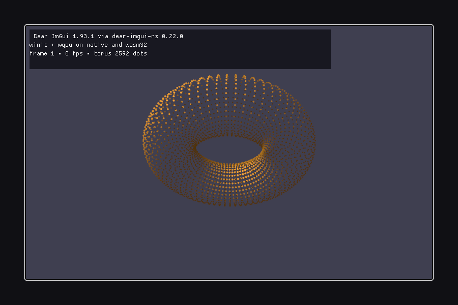

# dear-imgui-rs 0.22 demo: native winit + wasm32 browser

A small, working starting point for **Dear ImGui 1.93.1** through `dear-imgui-rs 0.22.0`,
with:

- a native `winit` + `wgpu` window, and
- the same UI compiled to `wasm32-unknown-unknown` and running in a browser on WebGL2.

Both targets draw a spinning torus (2592 points) through the ImGui draw list and show an
overlay with frame count, fps, and point count.

| Native (58 fps, debug, 1904x1040) | wasm32 in Chromium |
|---|---|
|  |  |

The browser build is the unusual part: `dear-imgui-rs 0.22` expects an external WebAssembly
provider (`imgui-sys-v1`) that is **not published on crates.io**. This project builds it once
from the pinned upstream release commit and keeps it out of git. Everything else is
crates.io-only.

> If you only want the native build, you can stop after step 1 and ignore the provider.

---

## 1. Quick start

Everything runs inside the Nix dev shell. `nix develop` provides Rust, `wasm-bindgen`,
`wasm-tools`, Python, Clang, and the native window/GPU libraries.

### Native

```sh
nix develop -c make native
# or: nix develop -c cargo run
```

### Browser (first time: build the provider, ~5-10 minutes)

```sh
nix develop -c make provider   # clones the pinned upstream checkout, builds imgui-sys-v1
nix develop -c make web        # builds the app, runs wasm-bindgen, patches shared memory
nix develop -c make check      # verifies the bundle wiring
nix develop -c make serve      # http://127.0.0.1:8088/
```

On every later change only `make web` is needed; `make provider` is a one-time step (or after
changing the provider pin). `make serve PORT=9000` uses another port.

The browser must support WebGL2. There is no server-side component.

### Without Nix

Install Rust ≥ 1.95 (with the `wasm32-unknown-unknown` target), `wasm-bindgen-cli 0.2.130`,
`wasm-tools`, Python 3, Clang, Emscripten (for the provider), and the Wayland/X11/Vulkan
development libraries. `flake.nix` is the exact reference for package names and versions. Then
use the same `make` targets outside `nix develop`.

---

## 2. What is where

| Path | What it is |
|---|---|
| `src/lib.rs` | The whole demo: application state, winit/wgpu setup, torus renderer, native and wasm entry points |
| `src/main.rs` | Native binary entry point |
| `web/index.html` | Browser page: shared memory, import map, canvas styling, error overlay |
| `web/probe.html` | The same page without the provider; shows the crates.io-only failure |
| `web/pkg/` | Generated wasm-bindgen output (gitignored) |
| `web/provider/` | Generated `imgui-sys-v1` provider files (gitignored) |
| `scripts/build-provider.sh` | Builds the provider from the pinned upstream checkout |
| `scripts/patch_web_glue.py` | Makes the app and provider share one linear memory |
| `scripts/patch_xtask_emscripten.py` | Emscripten 6 compatibility fix for the upstream provider build |
| `scripts/check_web_bundle.py` | Verifies that the browser bundle is complete and patched |
| `Makefile` | `native`, `provider`, `web`, `serve`, `check` targets |
| `flake.nix` | Default dev shell, plus a `provider` shell with Emscripten |
| `docs/` | Screenshots used by this README |

Generated directories (`target/`, `web/pkg/`, `web/provider/`, `.provider-src/`) are
gitignored. `web/provider/` can be rebuilt with `make provider`; it is not committed.

---

## 3. How the browser build works

A browser page cannot load a Rust `.wasm` that calls C++ symbols from nowhere. The pieces are:

1. **Provider** — `imgui-sys-v1.{js,wasm}`: Dear ImGui + cimgui compiled by Emscripten. It is
   built by the upstream `xtask` from commit `7424350…` (the 0.22.0 release commit).
2. **Application** — `web/pkg/dear_imgui_demo.{js,wasm}`: the Rust app compiled by Cargo,
   post-processed by `wasm-bindgen`.
3. **Shared memory** — the provider and the app use one `WebAssembly.Memory`:
   - `web/index.html` creates `globalThis.__imgui_shared_memory` (128 MiB, max 256 MiB) before
     any module script runs.
   - `scripts/patch_web_glue.py` rewrites the app wasm so its memory is
     `(import "env" "memory")` and injects that object into the wasm-bindgen init code.
   - The provider places its static data at 64 MiB (`GLOBAL_BASE=67108864`); the Rust module
     uses the low region.
4. **Import map** — `web/index.html` maps the bare specifier `imgui-sys-v1` to
   `./provider/imgui-sys-v1-wrapper.js`. The wrapper waits for the provider to initialize and
   re-exports every `ig*` function.

On wasm the app forces `wgpu::Backends::GL` (WebGL2) and requests adapter-derived limits.
`web/index.html` explains why in comments.

---

## 4. Customize it

All paths are relative to this directory. Rebuild and rerun after each change:

- native: `nix develop -c make native`
- browser: `nix develop -c make web`, then reload `http://127.0.0.1:8088/`

### 4.1 Window title and size

Search for `Window::default_attributes()` in `resumed()` in `src/lib.rs`:

```rust
let mut attributes = Window::default_attributes()
    .with_title("dear-imgui-rs 0.22 - winit + wgpu")
    .with_inner_size(LogicalSize::new(800.0, 500.0));
```

The `with_append(true)` block just below is required on web; without it winit creates a
detached canvas and the window is 0x0.

### 4.2 UI text and widgets

The overlay is the `ui.window("canvas")` block in `redraw()`. Change the `ui.text(...)` lines
directly.

To add an interactive widget you need input enabled and state that lives across frames:

```rust
struct DemoState {
    // ...
    spin: bool, // add this field, initialize it in DemoState::new
}

// remove WindowFlags::NO_INPUTS from the flags in redraw()
ui.checkbox("Spin", &mut self.spin);
ui.slider_f32("Speed", &mut self.speed, 0.0, 3.0);
```

(That is a sketch; keep state in `DemoState` so it survives between frames.)

**Important for the browser:** the whole UI must stay inside **one ImGui window**, because
`imgui-wgpu` on WebGL panics when an `ImDrawCmd` has a non-zero vertex offset. Do not add a
second window or use the background/foreground draw list in the browser build. A checkbox
inside the existing full-display window is fine.

### 4.3 The torus

Constants and rotation are in `draw_torus` / the top of `src/lib.rs`:

```rust
const TORUS_MAJOR: f32 = 1.0;   // ring radius
const TORUS_MINOR: f32 = 0.42;  // tube radius
const TORUS_THETA: usize = 72;  // dots around the ring
const TORUS_PHI: usize = 36;    // dots around the tube
```

```rust
let (rot_x_sin, rot_x_cos) = (time * 0.55).sin_cos(); // tilt speed
let (rot_y_sin, rot_y_cos) = (time * 0.9).sin_cos();  // spin speed
let light = [-0.45_f32, 0.55, -0.70];                 // light direction
```

Dot color and size:

```rust
let color = Color::from_rgba_bytes(
    (255.0 * shade) as u8,
    (170.0 * shade) as u8,
    (55.0 * shade) as u8,
    245,
);
draw_list.add_circle([x, y], 1.3 + 0.7 * shade, color)...
```

`TORUS_THETA * TORUS_PHI` dots are emitted every frame; raising both much above 72x36 increases
CPU time and vertex count. Points are sorted back-to-front, so no depth buffer is needed.

### 4.4 Colors and style

- Background clear color: `wgpu::Color { r: 0.05, g: 0.05, b: 0.08, a: 1.0 }` in the
  `RenderPassColorAttachment` in `redraw()`.
- ImGui global style (padding, rounding, colors): use `context.style_mut()` after creating
  the context, e.g. `self.context.style_mut().set_window_rounding(8.0);`.

### 4.5 Browser page

`web/index.html` contains the CSS, the shared memory size, and the import map:

```js
globalThis.__imgui_shared_memory = new WebAssembly.Memory({
  initial: 2048,   // 128 MiB; the provider was built with INITIAL_MEMORY=134217728
  maximum: 4096,   // 256 MiB; must stay <= 32768 (provider limit)
});
```

If you raise these, keep the initial size at least 2048 pages; the provider needs 128 MiB.
`maximum` must not exceed the provider's 32768-page limit. The CSS controls the canvas
position and size; the canvas itself is created by winit and appended to `<body>`.

### 4.6 Use WebGPU instead of WebGL (advanced, not tested here)

On wasm the app currently forces WebGL:

```rust
if cfg!(target_arch = "wasm32") {
    instance_desc.backends = wgpu::Backends::GL;
}
```

To try WebGPU, enable `dear-imgui-wgpu/webgpu` in the `web` feature in `Cargo.toml` and let the
instance use its default backends (remove the line above). Browsers expose WebGPU only in
secure contexts (localhost is fine); headless Chromium often advertises `navigator.gpu`
without a usable adapter, which is why the default is WebGL.

### 4.7 Update the provider pin

`scripts/build-provider.sh` uses:

```sh
PIN=${PROVIDER_PIN:-7424350518efb54693b8acd4a417b69d9d0f015b}
```

This is the commit that produced the published 0.22.0 crates. The provider ABI is `imgui-sys-v1`;
a provider from a different release train may not match the bindings in `dear-imgui-rs 0.22.0`.
If you update it, rebuild with `make provider` and run `make check`.

### 4.8 Add a dependency

```sh
nix develop -c cargo add <crate>
```

It must compile for `wasm32-unknown-unknown` if you want the browser build. Let Cargo select
the version, and check the crate's feature flags for wasm support. Native-only crates can be
placed in `[target.'cfg(not(target_arch = "wasm32"))'.dependencies]`.

---

## 5. The Python scripts

Run them inside `nix develop` (they need `wasm-tools` and Python 3 there).

### `scripts/patch_web_glue.py`

Turns the wasm-bindgen output into a module that imports the provider's memory.

```sh
python3 scripts/patch_web_glue.py web/pkg/dear_imgui_demo_bg.wasm web/pkg/dear_imgui_demo.js
```

What it changes, in two idempotent steps:

1. `wasm-tools print` to WAT, replace the module's own `(memory ...)` with
   `(import "env" "memory" (memory (;0;) 256 32768))`, re-export it as `memory`, then
   `wasm-tools parse` back to wasm.
2. Insert `globalThis.__imgui_shared_memory` into the JS init:
   `const imports = __wbg_get_imports();` is followed by code that sets `imports.env.memory`.

If it prints `marker ... not found`, wasm-bindgen changed its generated glue. Open
`web/pkg/dear_imgui_demo.js`, find where the imports are created, and update `JS_MARKER` in
the script. If the WAT has no `(module ...)` or `(memory ...)`, the input is not a
wasm-bindgen output; rebuild with `make web`.

### `scripts/patch_xtask_emscripten.py`

Emscripten 6 removed the `allocate` runtime helper, but the pinned 0.22.0 `xtask` still lists it
and aborts during JS finalization. The script removes that one entry from the local checkout.

```sh
python3 scripts/patch_xtask_emscripten.py .provider-src/dear-imgui-rs/xtask/src/main.rs
python3 scripts/patch_xtask_emscripten.py --check .provider-src/dear-imgui-rs/xtask/src/main.rs
```

`--check` writes nothing and exits `1` if the patch is still needed. `build-provider.sh` runs
the patching variant automatically.

### `scripts/check_web_bundle.py`

A doctor for the browser bundle:

```sh
python3 scripts/check_web_bundle.py   # or: make check
```

It checks that the provider files and wasm-bindgen outputs exist, that `index.html` has the
import map and shared memory, that the generated JS imports `imgui-sys-v1` and injects
`__shared_mem`, and that the wasm imports `env.memory`. Exit code `0` means the bundle is
wired; each failing line tells you which command to rerun.

`scripts/build-provider.sh` is shell on purpose: it orchestrates git, Nix, and Cargo. The
Python scripts only do text/byte-level edits, where Python is the right tool.

---

## 6. Common errors

| Message | Cause | Fix |
|---|---|---|
| `missing provider: run 'make provider' first` | `web/provider/` is empty | `nix develop -c make provider` |
| `Failed to resolve module specifier "imgui-sys-v1"` | provider missing or import map absent | run `make provider`; check `web/index.html` |
| `Import #0 "env": module is not an object or function` | JS shared-memory injection missing | `make web`; check `make check` |
| `Draw elements instanced base vertex is not supported` | more than one ImGui draw command on WebGL | keep one full-display window; no background draw list |
| `delta_time must be positive` | two frames in less than 1 ms | the pacing guard in `redraw()` handles it; don't remove it |
| `undefined exported symbol: "allocate"` | Emscripten 6 vs 0.22.0 xtask | `python3 scripts/patch_xtask_emscripten.py <checkout>/xtask/src/main.rs` |
| `ReferenceError: imports is not defined` | upstream xtask's JS injection with wasm-bindgen 0.2.130 | use this project's `patch_web_glue.py`, not the upstream patch |
| `No available adapters` | browser has no usable GPU adapter | try WebGL (default), or start Chromium with SwiftShader flags |
| `wasm-tools: command not found` | running outside the dev shell | prefix with `nix develop -c` |
| wasm MIME error | page served from `file://` or wrong server | use `make serve`; `python3 -m http.server` serves `.wasm` correctly |
| blank canvas, 0x0 window | missing `with_append(true)` on web | restore it in `resumed()` |

Headless Chromium verification (SwiftShader):

```sh
nix run nixpkgs#chromium -- --headless=new --no-sandbox \
  --use-gl=angle --use-angle=swiftshader --enable-unsafe-swiftshader \
  --window-size=900,600 --virtual-time-budget=8000 \
  --screenshot=/tmp/wasm.png http://127.0.0.1:8088/
```

A normal desktop browser uses the real GPU and shows a live, rotating torus.

---

## 7. Tests

```sh
nix develop -c cargo test     # torus math: bounds, unit normals, rotation length
nix develop -c make check     # browser bundle wiring
```

---

## 8. Limits and things that will bite you

- **The provider is not on crates.io.** The Rust app is crates.io-only (`Cargo.lock` has no git
  sources); only the provider generation step uses the upstream repository. `web/probe.html`
  demonstrates the pure-crates.io failure.
- **Provider ABI is pinned to 0.22.0.** Keep `dear-imgui-* = 0.22.0` and the provider commit
  together.
- **One draw command on WebGL.** See section 4.2. This is a `wgpu`/`glow` limitation, not an
  ImGui setting.
- **Single canvas, no multi-viewport.** Upstream's wasm backends are single-window; native
  multi-viewport features are not available here.
- **128 MiB shared memory.** The provider is compiled with `INITIAL_MEMORY=134217728`; the
  page must provide at least that much.
- **Debug builds are slower.** The 58 fps native figure is a debug build; `--release` is
  faster but not needed for this demo.
- **Licensing.** `dear-imgui-rs` and the provider are MIT OR Apache-2.0; the generated provider
  files are not committed.
