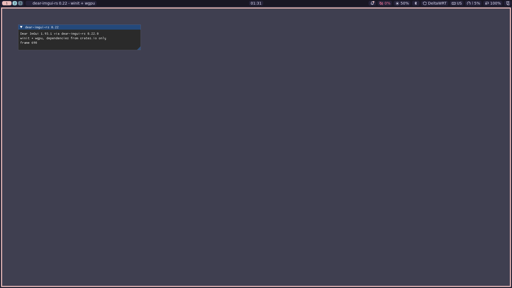

# dear-imgui-rs 0.22 minimal demo

Two targets share one application module (`src/lib.rs`):

1. Native `winit` window using `wgpu` and Dear ImGui. **Works.**
2. `wasm32-unknown-unknown` browser build. **Builds, but cannot be instantiated** because
   `dear-imgui-rs 0.22` obtains the Dear ImGui core from an external wasm provider module that
   is not published on crates.io.

All Rust dependencies come from crates.io; `Cargo.lock` contains zero git sources.

| Component | Version |
|---|---|
| `dear-imgui-rs` | 0.22.0 |
| `dear-imgui-winit` | 0.22.0 |
| `dear-imgui-wgpu` | 0.22.0 (wgpu 30) |
| `winit` | 0.30.13 |
| Rust | 1.99.1 (`rust-version = 1.95` required by the crates) |
| Dear ImGui (native C++) | 1.93.1 WIP docking |

## Native (winit)

```sh
nix develop -c cargo run
```

Verified on NixOS with niri/Wayland and the Intel Vulkan driver. The window shows a Dear ImGui
window with a live frame counter:



`WinitPlatform::prepare_frame`, `Context::frame`, `Context::render` and
`WgpuRenderer::render` are exercised every frame. The renderer is shut down explicitly before
the context is dropped.

## wasm32 (browser) - blocked by the published crates

```sh
nix develop -c make web    # cargo build --target wasm32-unknown-unknown + wasm-bindgen
nix develop -c make serve  # python3 -m http.server 8088 -d web
```

Open <http://127.0.0.1:8088/>. The page fails while loading the module:


```
TypeError: Failed to resolve module specifier "imgui-sys-v1".
Relative references must start with either "/", "./", or "../".
```

### Root cause

`dear-imgui-rs 0.22` changed the wasm build to an import-style ABI. On
`wasm32-unknown-unknown` with the `wasm` feature, `dear-imgui-sys` does not compile the C++
core. It emits declarations in the `imgui-sys-v1` wasm import module (86 imported functions in
this demo after dead-code elimination):

```sh
wasm-objdump -x target/wasm32-unknown-unknown/release/dear_imgui_demo.wasm \
  | grep -c imgui-sys-v1
# 86
```

`wasm-bindgen` turns those into ES module imports of the bare specifier `imgui-sys-v1`, so the
browser requires a JavaScript module (normally installed through an import map) that exports the
provider. The provider is the Dear ImGui + cimgui core compiled once with Emscripten, and it
must share one `WebAssembly.Memory` with the Rust module.

The published crates do not contain that provider:

- `dear-imgui-sys 0.22.0` tarball has no `.wasm` or loader files; its `build.rs` explicitly
  skips compilation for wasm targets (`CoreBuildOutcome::WasmImports`) and states:
  "The WASM provider is compiled separately by xtask."
- The crate README instructs users to run `cargo run -p xtask -- build-cimgui-provider` and
  `cargo run -p xtask -- web-demo`. `xtask`, `docs/WASM.md`, and `examples-wasm/` exist only in
  the source repository and are not part of any crates.io package.
- The `wasm + prebuilt` combination is rejected by the build script, so the prebuilt native
  archives cannot substitute for the provider.
- The crates.io package list for `dear-imgui` and `cimgui` contains only bindings, backends, and
  extensions. Nothing publishes a `imgui-sys-v1` provider or a loader for it.

Consequently, under the constraint "crates.io only, no repository checkout", the browser target
cannot be completed. The failure is in the dependency's distribution model, not in this project.

## Options

1. **Relax the constraint** and let the project use the repository's `xtask` (or the release
   provider artifact). This is the supported path and the only one that keeps the ABI contract
   verified by the crate.
2. **Build a local provider** from the cimgui sources that *are* vendored inside
   `dear-imgui-sys 0.22.0` (crates.io), using Emscripten, and supply the required
   `imgui-sys-v1` JavaScript module. This obeys the crates.io-only rule but requires
   reconstructing the unpublished build (source transforms, export list, memory sharing,
   allocator strategy) and is not a "minimal demo". It also has no ABI guarantee from upstream.
3. **Use another UI stack for the browser target** and keep `dear-imgui-rs 0.22` for native
   only.

## Layout

| Path | Purpose |
|---|---|
| `src/lib.rs` | Shared application, native entry, wasm entry |
| `src/main.rs` | Native binary |
| `web/index.html` | Probe page that loads the wasm build and reports errors |
| `Makefile` | `native`, `web`, `serve` targets |
| `flake.nix` | Rust 1.99, clang, wasm-bindgen 0.2.130, runtime libraries for winit/wgpu |
